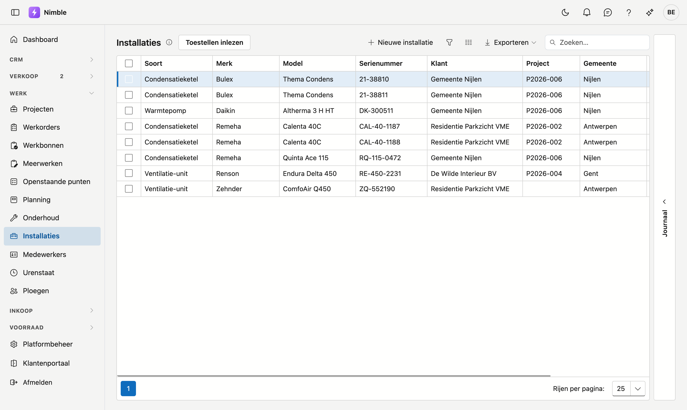
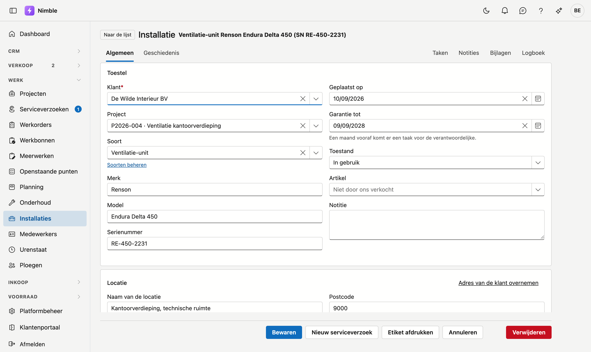

# Installaties

Een installatie is wat er bij een klant staat: een ketel, een warmtepomp, een ventilatie-unit. U houdt bij wat er staat, waar, met
welk serienummer en tot wanneer de garantie loopt. Per installatie ziet u welke bezoeken en herstellingen er waren, en wat er bij
elke controle niet in orde was.

## Het scherm openen

Klik in de zijbalk op **Werk → Installaties**.

U vindt de installaties van één klant ook op het tabblad **Installaties** van de [relatiefiche](../relations.md#tabblad-installaties), en die
van één project op het tabblad [Onderhoud](maintenance.md#het-tabblad-onderhoud-van-het-project) van het project.

## De lijst

| Kolom | Wat het is |
|---|---|
| **Soort** | Ketel, warmtepomp, ventilatie-unit … uit de keuzelijst [Soorten installatie](../administration/installation-types.md) |
| **Merk** en **Model** | Wat er op het typeplaatje staat |
| **Serienummer** | Hiermee houdt u twee gelijke installaties uit elkaar |
| **Klant** | De klant bij wie de installatie staat |
| **Project** | Het project waarbij de installatie hoort, als dat er is |
| **Gemeente** | Waar de installatie staat |
| **Garantie tot** | De laatste dag van de garantie |
| **Toestand** | In gebruik, Buiten gebruik of Vervangen |

- **Nieuwe installatie** opent een lege fiche.
- **Installaties inlezen** leest een lijst in uit Excel, zie [Installaties inlezen](#installaties-inlezen).
- Vink rijen aan om hun QR-stickers af te drukken met **Etiketten afdrukken**, zie [De QR-sticker](#de-qr-sticker).

Rechts zit de lade **Journaal** van de installatie waarop uw cursor staat: taken, notities, bijlagen en logboek.

## De fiche

Dubbelklik op een rij om de fiche te openen. Bovenaan staat de naam van de installatie met haar serienummer.

| Veld | Wat het is |
|---|---|
| **Klant** | Verplicht. De installatie blijft bij de klant, ook als het project afgerond is |
| **Project** | Het project waarbij de installatie geplaatst werd of onderhouden wordt. Mag leeg blijven |
| **Soort** | Uit de keuzelijst. **Soorten beheren** opent die lijst |
| **Merk**, **Model**, **Serienummer** | Vul minstens de soort, het merk, het model of het serienummer in. Staat hetzelfde serienummer al bij een andere installatie, dan meldt de fiche het |
| **Geplaatst op** | De dag van de plaatsing |
| **Garantie tot** | De laatste dag van de garantie. Een maand vooraf komt er een taak voor de verantwoordelijke |
| **Toestand** | In gebruik, Buiten gebruik of Vervangen. Een installatie die niet meer in gebruik is, kiest u niet meer bij een bezoek |
| **Artikel** | Het artikel uit uw voorraad, als u de installatie zelf verkocht. Anders *Niet door ons verkocht* |
| **Notitie** | Vrije tekst |

In de kaart **Locatie** staat waar de installatie staat: een **Naam van de locatie** (bijvoorbeeld *stookruimte*) en het adres.
**Adres van de klant overnemen** en **Werfadres overnemen** vullen het adres in vanuit de klant of de werf van het project.

Meldt de klant een storing aan deze installatie, klik dan op **Nieuw serviceverzoek**. Het venster opent met de klant en de installatie al
ingevuld, zie [Serviceverzoeken](service-requests.md#een-nieuw-verzoek). U ziet de knop wanneer u werk mag bewerken.

### Geschiedenis

Het tabblad **Geschiedenis** toont deze kaarten:

- **Controles**: elke keer dat de installatie op een werkbon nagekeken werd, met de dag, het besluit en de punten die niet in orde
  waren. De dag is een link naar de werkbon.
- **Lopend**: de open serviceverzoeken over deze installatie, met hun status en, bij een dringend verzoek, het label **Dringend**.
  Klik het nummer om het verzoek te openen. Heeft het project onderhoudsbezoeken, dan staat er ook de link **Naar het
  onderhoudsplan van het project**: die opent het tabblad Onderhoud van het project. Loopt er niets en heeft het project geen
  onderhoud, dan staat deze kaart er niet.
- **Bezoeken en herstellingen**: de werkorders van de installatie, de nieuwste eerst: de onderhoudsbezoeken en de herstellingen.

## De QR-sticker

Elke installatie kan een QR-sticker krijgen. Wie hem scant met de app van Nimble, opent meteen die installatie. Met een gewone camera ziet
men enkel de naam en het telefoonnummer van uw firma. Zet u **Iedereen met de sticker kan een storing melden** aan bij
[Opvolging](../administration/lead-follow-up.md#serviceverzoeken), dan staat daar ook de knop **Storing melden**: zie
[Een melding via de QR-sticker](service-requests.md#een-melding-via-de-qr-sticker).

- Op de fiche: **Etiket afdrukken**.
- In de lijst: vink de installaties aan en klik op **Etiketten afdrukken**.

Het venster drukt af op een A4-vel met 3 × 8 etiketten van 70 × 37 mm. Is het vel al half gebruikt, klik dan op het eerste vrije
etiket. Klik op **Voorbeeld** en druk af op ware grootte (100 %), niet *passend op de pagina*.

!!! info "Opnieuw afdrukken kan altijd"
    Heeft de installatie al een sticker, dan drukt u hetzelfde etiket opnieuw af zonder risico. Kies enkel een **nieuwe code** als
    de oude sticker verloren of in verkeerde handen is: de vorige sticker werkt dan niet meer.

## Installaties inlezen

Hebt u uw installaties al in een Excel-lijst, lees ze dan in. Klik in de lijst op **Installaties inlezen**.

1. **Bestand**: klik op **Sjabloon downloaden** voor een leeg Excel-bestand met de juiste kolommen, vul het in en kies het.
2. **Voorbeeld**: per regel ziet u wat er zal gebeuren: nieuw, bestaat al, of overgeslagen met de reden. Er is nog niets bewaard.
3. Klik op **Inlezen**. Daarna ziet u een samenvatting en de regels die niet ingelezen werden, met hun reden.

| Kolom | Wat erin hoort |
|---|---|
| **Klant** | Verplicht: het relatienummer of de naam van de klant |
| **Project** | De code van het project, bijvoorbeeld P2026-006. Het project moet bij die klant horen |
| **Soort** | Een soort die nog niet bestaat, maakt Nimble aan |
| **Merk**, **Model**, **Serienummer** | Minstens één van de drie, of een soort |
| **Geplaatst op**, **Garantie tot** | Een datum als dag/maand/jaar |
| **Plaats**, **Straat**, **Postcode**, **Gemeente** | Waar de installatie staat. Leeg: de werf van het project, anders het adres van de klant |
| **Notitie** | Vrije tekst |

!!! info "Een installatie die al bestaat"
    Staat er bij die klant al een installatie met hetzelfde serienummer, dan slaat Nimble de regel over. U kunt hetzelfde bestand dus
    gerust opnieuw inlezen.

## Veelgemaakte fouten

!!! warning "Een regel wordt overgeslagen met Meer dan één klant heet …"
    Twee relaties dragen dezelfde naam. Vul in de kolom **Klant** het relatienummer in.

!!! warning "Een installatie verschijnt niet in het venster Installaties kiezen"
    Het venster toont enkel installaties van de klant van het project, en enkel installaties die **In gebruik** zijn.

## Zie ook

- [Onderhoud](maintenance.md)
- [Soorten installatie](../administration/installation-types.md)
- [Werkbonnen](work-sheets.md#installaties)
- [Relaties](../relations.md)
