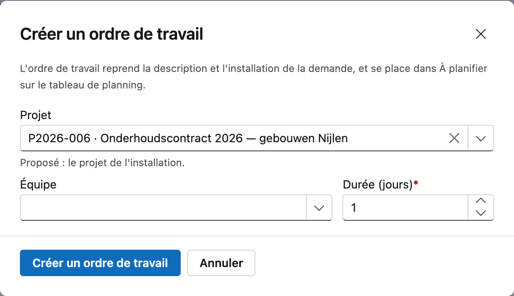

# Demandes d'intervention

Une demande d'intervention est un signalement d'un client : une panne, une demande de passage. Vous notez ce que le client signale, et
vous en faites un ordre de travail dès que quelqu'un doit passer. S'il n'y a pas de visite, vous clôturez la demande avec le motif.
Ainsi, aucun signalement ne reste en plan, pas même celui d'un client qui a simplement téléphoné.

## Ouvrir l'écran

Dans la barre latérale, cliquez sur **Travail → Demandes d'intervention**. Le nombre à côté de l'élément de menu est le nombre de
nouvelles demandes : celles que personne n'a encore prises en charge et qui n'ont pas encore d'ordre de travail.

Vous créez aussi une nouvelle demande depuis la fiche d'une [relation](../relations.md) ou d'une [installation](installations.md), avec
le bouton **Nouvelle demande d'intervention**. Le client, et pour une installation aussi l'appareil, sont alors déjà remplis.

## La liste

Le travail ouvert est en haut : les demandes urgentes d'abord, ensuite la plus ancienne. Cochez **Afficher aussi les terminées et
clôturées** pour voir aussi les demandes qui sont réglées.

| Colonne | Ce que c'est |
|---|---|
| **Numéro** | Le numéro de la demande, par exemple SV-2026-0001 |
| **Statut** | Où en est la demande, voir [Le statut](#le-statut) |
| **Urgent** | Si le client doit être aidé rapidement |
| **Client** | Le client qui a fait la demande |
| **Description** | La première ligne de ce que le client a signalé |
| **Appareil** | L'appareil concerné, si vous le connaissez |
| **Ouverte depuis** | Le jour où la demande est arrivée |
| **Ordre de travail** | L'ordre de travail de la demande, s'il existe |

Vous affichez la colonne **Responsable** avec le choix des colonnes de la liste.

À droite se trouve le tiroir **Journal** de la demande sur laquelle se trouve votre curseur : tâches, notes, pièces jointes et
historique.

## Une nouvelle demande

Cliquez sur **Nouvelle demande d'intervention**.

| Champ | Ce que c'est |
|---|---|
| **Client** | Obligatoire |
| **Personne de contact** | Qui a signalé chez le client. Peut rester vide |
| **Appareil** | Un appareil de ce client. Laissez-le vide si vous ne savez pas de quel appareil il s'agit |
| **Description** | Obligatoire : le problème. La première ligne figure dans la liste et dans l'e-mail au client |
| **Urgent** | Une demande urgente figure en haut de la liste, et sa tâche arrive à échéance aujourd'hui |
| **Envoyer un accusé de réception** | Envoie au client un e-mail confirmant que sa demande est bien reçue |

Cliquez sur **Nouvelle demande d'intervention** pour enregistrer. La fiche de la demande s'ouvre. Vous en êtes le responsable, le canal
est **Téléphone** et l'adresse de la visite est celle de l'appareil, sinon celle du client. Vous adaptez tout cela sur la fiche.

Nimble crée immédiatement une tâche **Traiter la demande d'intervention** pour le responsable. Elle arrive à échéance demain, pour une
demande urgente aujourd'hui.

!!! info "La case Envoyer un accusé de réception"
    La case n'apparaît que si votre entreprise avertit le client de sa demande d'intervention, voir
    [Suivi des leads, des devis et de l'entretien](../administration/lead-follow-up.md#demandes-dintervention). Elle est grisée s'il
    n'y a pas d'adresse e-mail : ni chez la personne de contact, ni chez le client. Celui qui téléphone a souvent déjà tout entendu :
    décochez-la alors.

## La fiche

Double-cliquez sur une ligne pour ouvrir la fiche. À côté du titre figurent le statut et, pour une demande urgente, l'étiquette
**Urgent**.

Au-dessus des cartes, la fiche indique ce que vous devez savoir avant de planifier une visite :

- **L'appareil est sous garantie jusqu'au …** : la garantie de l'appareil court encore.
- **L'appareil fait partie du contrat d'entretien de …** : le contrat couvre les visites d'entretien. Une réparation est facturée en
  régie, sauf si vous en décidez autrement.

La carte **Demande** contient le client, la personne de contact, l'appareil (avec le lien **Ouvrir l'appareil**), la description, le
responsable, le **Canal** (téléphone, e-mail, portail client, autocollant QR ou autre) et si la demande est urgente. Sous **Reçue le**,
vous voyez aussi si l'accusé de réception est parti.

Vous ne remplissez la carte **Demandeur et adresse** que si le demandeur n'est pas une personne de contact du client, par exemple un
locataire : son nom, son téléphone et son adresse e-mail. L'adresse est l'endroit où la visite a lieu.

La carte **Ordres de travail** montre les ordres de travail de la demande, avec le jour au planning ou *à planifier*.

À côté de **Général** se trouvent les onglets **Tâches**, **Notes**, **Pièces jointes** et **Historique**.

## Le statut

Le statut suit l'ordre de travail. À la main, vous ne mettez que **En cours** et **Clôturée sans visite**.

| Statut | Quand |
|---|---|
| **Nouvelle** | La demande est arrivée et personne ne l'a encore prise en charge |
| **En cours** | Quelqu'un l'a prise en charge avec **Prendre en charge**, ou elle a un ordre de travail sans jour au planning |
| **Planifiée** | Un ordre de travail de la demande a un jour au planning |
| **Terminée** | Tous les ordres de travail de la demande sont terminés |
| **Clôturée sans visite** | Vous l'avez clôturée avec **Clôturer sans visite** |

## Créer un ordre de travail

Si quelqu'un doit passer, cliquez sur **Créer un ordre de travail**.

Nimble propose un projet :

- le projet en cours de l'appareil ;
- sinon le seul projet en cours du client ;
- sinon un **nouveau projet**. Vous remplissez alors un numéro et un nom, et choisissez éventuellement un type de projet.

Choisissez l'**Équipe** et la **Durée (jours)** et cliquez sur **Créer un ordre de travail**. L'ordre de travail reprend la description
et l'appareil de la demande, et se place dans **À planifier** sur le [tableau de planning](planning.md). Dès que le planificateur le
glisse sur un jour, la demande passe à **Planifiée**.

En haut de l'ordre de travail figure un lien vers la demande d'intervention.

## Clôturer sans visite

S'il n'y a pas de visite, cliquez sur **Clôturer sans visite** et choisissez le **Motif** : **Résolue par téléphone**, **Renvoyée vers
le fabricant**, **Pas de commande** ou **Doublon**. Vous pouvez ajouter une **Remarque**. Le client ne reçoit pas d'e-mail à ce sujet.

La demande quitte le travail ouvert. **Rouvrir** la remet sur **Nouvelle**.

!!! info "Clôturer n'est possible que sans ordre de travail"
    Si la demande a un ordre de travail, le statut suit cet ordre de travail. Si la visite n'est plus nécessaire, supprimez l'ordre de
    travail.

## Avertir le client

Si **Avertir le client de sa demande d'intervention** est activé dans
[Suivi des leads, des devis et de l'entretien](../administration/lead-follow-up.md#demandes-dintervention), le client reçoit deux
e-mails :

- l'**accusé de réception**, quand vous créez la demande et laissez la case cochée ;
- une **confirmation du jour**, dès que l'ordre de travail a un jour au planning, et à nouveau si ce jour change.

L'e-mail part vers la personne de contact, sinon vers le demandeur, sinon vers le client, dans la langue du client. Vous adaptez les
textes dans [Modèles de mail](../settings/mail-templates.md).

## Erreurs fréquentes

!!! warning "Le bouton Clôturer sans visite n'apparaît pas"
    La demande a déjà un ordre de travail. Ouvrez l'ordre de travail depuis la carte **Ordres de travail**.

!!! warning "Le client n'a pas reçu d'accusé de réception"
    Regardez sous **Reçue le** sur la fiche. Il n'y avait pas d'adresse e-mail, la case était décochée, ou votre entreprise n'avertit
    pas le client.

## Voir aussi

- [Ordres de travail](work-orders.md)
- [Planning](planning.md)
- [Installations](installations.md)
- [Suivi des leads, des devis et de l'entretien](../administration/lead-follow-up.md)
- [Modèles de mail](../settings/mail-templates.md)
