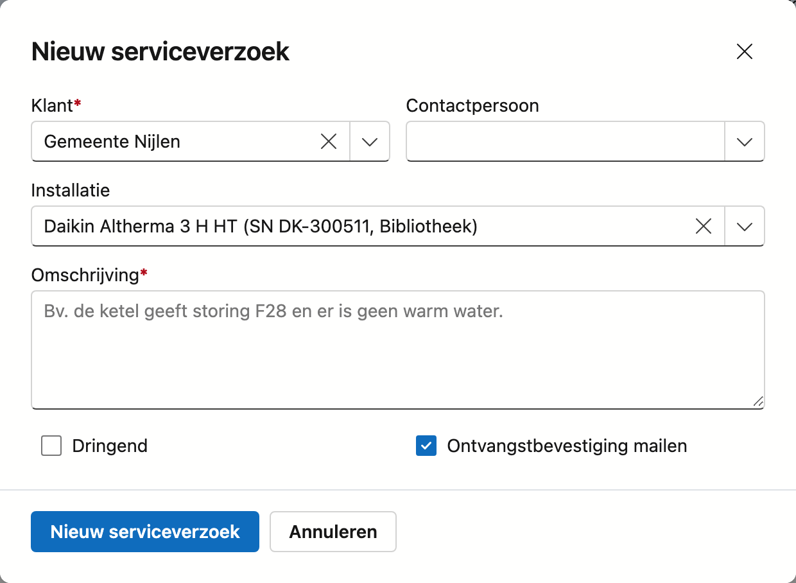
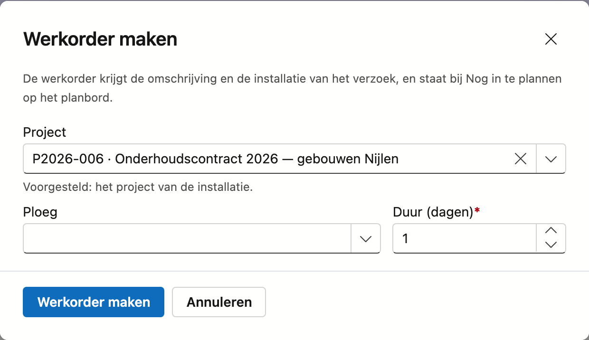

# Serviceverzoeken

Een serviceverzoek is een melding van een klant: een storing, een vraag om langs te komen. U noteert wat de klant meldt, en maakt er
een werkorder van zodra er iemand langs moet. Komt er geen bezoek, dan sluit u het verzoek af met de reden. Zo blijft geen enkele
melding liggen, ook niet die van een klant die alleen even belde.

## Het scherm openen

Klik in de zijbalk op **Werk → Serviceverzoeken**. Het getal naast het menu-item is het aantal nieuwe verzoeken: verzoeken die nog
niemand opnam en die nog geen werkorder hebben.

Een nieuw verzoek maakt u ook vanaf de fiche van een [relatie](../relations.md) of van een [installatie](installations.md), met de knop
**Nieuw serviceverzoek**. De klant staat dan al ingevuld, en vanaf een installatie ook die installatie.

## De lijst

Het open werk staat bovenaan: de dringende verzoeken eerst, daarna het oudste. Vink **Ook afgewerkte en afgesloten tonen** aan om ook
de verzoeken te zien die klaar zijn.

| Kolom | Wat het is |
|---|---|
| **Nummer** | Het nummer van het verzoek, bijvoorbeeld SV-2026-0001 |
| **Status** | Waar het verzoek staat, zie [De status](#de-status) |
| **Dringend** | Of de klant snel geholpen moet worden |
| **Klant** | De klant die het verzoek deed |
| **Omschrijving** | De eerste regel van wat de klant meldde |
| **Installatie** | De installatie waarover het gaat, als u ze kent |
| **Open sinds** | De dag waarop het verzoek binnenkwam |
| **Werkorder** | De werkorder van het verzoek, als die er is. Klik het nummer om de werkorder te openen |

De kolom **Verantwoordelijke** zet u aan met de kolomkeuze van de lijst.

Rechts zit de lade **Journaal** van het verzoek waarop uw cursor staat: taken, notities, bijlagen en logboek.

## Een nieuw verzoek

Klik op **Nieuw serviceverzoek**.

| Veld | Wat het is |
|---|---|
| **Klant** | Verplicht |
| **Contactpersoon** | Wie bij de klant meldde. Mag leeg blijven |
| **Installatie** | Een installatie van die klant. Laat het leeg als u niet weet om welke installatie het gaat |
| **Omschrijving** | Verplicht: wat er is. De eerste regel staat in de lijst en in de mail aan de klant |
| **Dringend** | Een dringend verzoek staat bovenaan de lijst, en zijn taak vervalt vandaag |
| **Ontvangstbevestiging mailen** | Stuurt de klant een mail dat zijn verzoek goed ontvangen is |

Klik op **Nieuw serviceverzoek** om te bewaren. De fiche van het verzoek opent. U bent de verantwoordelijke, het kanaal staat op
**Telefoon** en het adres van het bezoek is dat van de installatie, anders dat van de klant. Dat alles past u aan op de fiche.

Nimble maakt meteen een taak **Serviceverzoek behandelen** voor de verantwoordelijke. Ze vervalt morgen, bij een dringend verzoek
vandaag. Maakt u een werkorder of sluit u het verzoek af zonder bezoek, dan vinkt Nimble die taak af.

!!! info "Het vinkje Ontvangstbevestiging mailen"
    Het vinkje staat er enkel als uw bedrijf de klant verwittigt over zijn serviceverzoek, zie
    [Opvolging van leads, offertes, onderhoud en serviceverzoeken](../administration/lead-follow-up.md#serviceverzoeken). Het is grijs als er geen
    e-mailadres is: niet bij de contactpersoon en niet bij de klant. Wie belt, heeft vaak al alles gehoord: vink het dan uit.

## De fiche

Dubbelklik op een rij om de fiche te openen. Naast de titel staan de status en, bij een dringend verzoek, het label **Dringend**.

Boven de kaarten meldt de fiche wat u moet weten voor u een bezoek plant:

- **De installatie is onder garantie tot …**: de garantie van de installatie loopt nog.
- **De installatie hoort bij het onderhoudscontract van …**: het contract dekt de onderhoudsbezoeken. Een herstelling gaat in regie, tenzij u
  anders beslist.

De kaart **Verzoek** bevat de klant, de contactpersoon, de installatie (met de link **Installatie openen**), de omschrijving, de verantwoordelijke,
het **Kanaal** (telefoon, e-mail, klantenportaal, QR-sticker of ander) en of het verzoek dringend is. Bij **Ontvangen op** ziet u ook of
de ontvangstbevestiging vertrok.

De kaart **Melder en adres** vult u enkel in als wie meldde geen contactpersoon van de klant is, bijvoorbeeld een huurder: zijn naam,
telefoon en e-mailadres. Bij een [melding uit het portaal](#een-melding-uit-het-portaal) vult Nimble ze zelf in. Het adres is waar
het bezoek gebeurt.

De kaart **Werkorders** toont de werkorders van het verzoek, met de dag op het planbord of *nog in te plannen*.

Naast **Algemeen** staat het tabblad **Journaal**, met **Taken**, **Notities**, **Bijlagen** en **Logboek**.

## De status

De status volgt de werkorder. Met de hand zet u enkel **In behandeling** en **Afgesloten zonder bezoek**.

| Status | Wanneer |
|---|---|
| **Nieuw** | Het verzoek kwam binnen en niemand nam het nog op |
| **In behandeling** | Iemand nam het op met **Opnemen**, of het heeft een werkorder zonder dag op het planbord |
| **Ingepland** | Een werkorder van het verzoek heeft een dag op het planbord |
| **Afgewerkt** | Alle werkorders van het verzoek zijn afgewerkt |
| **Afgesloten zonder bezoek** | U sloot het af met **Afsluiten zonder bezoek** |

## Een werkorder maken

Moet er iemand langs, klik dan op **Werkorder maken**.

Nimble stelt een project voor:

- het lopende project van de installatie;
- anders het enige lopende project van de klant;
- anders een **nieuw project**. Dan vult u een nummer en een naam in, en kiest u eventueel een projecttype.

Kies de **Ploeg** en de **Duur (dagen)** en klik op **Werkorder maken**. De werkorder krijgt de omschrijving en de installatie van het
verzoek, en staat bij **Nog in te plannen** op het [planbord](planning.md). Sleept de planner hem op een dag, dan staat het verzoek
op **Ingepland**.

Op de werkorder staat bovenaan een link terug naar het serviceverzoek.

## Afsluiten zonder bezoek

Komt er geen bezoek, klik dan op **Afsluiten zonder bezoek** en kies de **Reden**: **Telefonisch opgelost**, **Doorverwezen naar de
fabrikant**, **Geen opdracht** of **Dubbel**. Een **Toelichting** mag erbij. De klant krijgt hierover geen mail.

Het verzoek verdwijnt uit het open werk. **Heropenen** zet het terug op **Nieuw**.

!!! info "Afsluiten kan enkel zonder werkorder"
    Heeft het verzoek een werkorder, dan volgt de status die werkorder. Is het bezoek niet meer nodig, haal dan de werkorder weg.

## Een melding uit het portaal

Staat **Klanten kunnen een storing melden in het portaal** aan bij
[Opvolging van leads, offertes, onderhoud en serviceverzoeken](../administration/lead-follow-up.md#serviceverzoeken), dan meldt een
klant met toegang tot het [portaal voor uw klanten](../crm/portaal-voor-klanten.md#storing-melden) zelf een storing. Het verzoek komt
binnen zoals een verzoek van kantoor: met de status **Nieuw** en de taak **Serviceverzoek behandelen**, en met:

- het kanaal **Klantenportaal**;
- de klant, de installatie als hij ze koos, de omschrijving en of het dringend is, zoals hij ze invulde;
- als **Contactpersoon** de persoon die meldde, als hij een contactpersoon van de klant is met hetzelfde e-mailadres. Bij
  **Melder en adres** staan zijn naam, zijn e-mailadres en het telefoonnummer om hem terug te bellen;
- het adres van de installatie, anders dat van de klant;
- als **Verantwoordelijke** de verantwoordelijke van de klant op de [relatiefiche](../relations.md), anders wie bij **Verantwoordelijke
  voor verzoeken uit het portaal** staat. Staat daar niemand, dan staat de taak bij **Niemand**;
- de foto's onder **Journaal** › **Bijlagen**.

U behandelt het verder zoals elk verzoek. De klant volgt de stand in het portaal bij **Mijn meldingen**.

## Een melding via de QR-sticker

Staat **Iedereen met de sticker kan een storing melden** aan bij
[Opvolging van leads, offertes, onderhoud en serviceverzoeken](../administration/lead-follow-up.md#serviceverzoeken), dan staat de
knop **Storing melden** op de pagina die opent wanneer iemand de [QR-sticker](installations.md#de-qr-sticker) van een installatie scant
met zijn gsm. Wie meldt, hoeft niet aan te melden: een huurder, de poetsdienst of de conciërge kan het ook. Hij vult in:

- zijn **naam** en **telefoonnummer** (verplicht);
- een **e-mailadres** voor de bevestiging (niet verplicht);
- **wat er is**, en of het **dringend** is;
- hoogstens 3 **foto's** van elk 8 MB. Op een gsm opent de camera of de fotogalerij.

Na **Versturen** ziet hij het nummer van zijn melding en uw telefoonnummer. Het verzoek komt binnen met de status **Nieuw**, de taak
**Serviceverzoek behandelen**, en met:

- het kanaal **QR-sticker**;
- de klant en de installatie van de sticker. Wat de melder intikt, verandert daar niets aan;
- bij **Melder en adres** zijn naam, telefoonnummer en e-mailadres. Is hij een contactpersoon van de klant met hetzelfde
  e-mailadres, dan staat hij ook bij **Contactpersoon**;
- het adres van de installatie, anders dat van de klant;
- als **Verantwoordelijke** de verantwoordelijke van de klant, anders wie bij **Verantwoordelijke voor verzoeken uit het portaal en
  via de sticker** staat;
- de foto's onder **Journaal** › **Bijlagen**.

Bovenaan de fiche staat dan: *Gemeld via de QR-sticker door iemand die niet aangemeld is. Bel de melder na voor u een bezoek plant.*
Die melding verdwijnt zodra u het verzoek opneemt of er een werkorder van maakt. Is de melding vals, dan haalt u het verzoek weg met
**Verwijderen**.

De melder krijgt een ontvangstbevestiging als hij een e-mailadres invulde en **De klant verwittigen over zijn serviceverzoek** aan
staat.

!!! info "Grenzen tegen misbruik"
    Via één sticker komen hoogstens 3 meldingen per 24 uur binnen, en via alle stickers van uw bedrijf samen 30. Daarboven ziet de
    melder uw telefoonnummer in plaats van het formulier. Een geweigerde melding staat in het [Actielogboek](../administration/audit-log.md)
    op **Platformbeheer**. De pagina toont niets over uw klant of de installatie: enkel uw firma.

## De klant verwittigen

Staat **De klant verwittigen over zijn serviceverzoek** aan bij
[Opvolging van leads, offertes, onderhoud en serviceverzoeken](../administration/lead-follow-up.md#serviceverzoeken), dan krijgt de klant twee mails:

- de **ontvangstbevestiging**, wanneer u het verzoek maakt en het vinkje aanlaat;
- een **bevestiging van de dag**, zodra de werkorder een dag heeft op het planbord, en opnieuw als die dag verschuift.

De mail gaat naar de contactpersoon, anders naar de melder, anders naar de klant, in de taal van de klant. De teksten past u aan op
[Mailsjablonen](../settings/mail-templates.md).

## Veelgemaakte fouten

!!! warning "De knop Afsluiten zonder bezoek ontbreekt"
    Het verzoek heeft al een werkorder. Open de werkorder vanaf de kaart **Werkorders**.

!!! warning "De klant kreeg geen ontvangstbevestiging"
    Kijk bij **Ontvangen op** op de fiche. Er was geen e-mailadres, het vinkje stond uit, of uw bedrijf verwittigt de klant niet.

!!! warning "De knop Storing melden staat niet op de pagina van de sticker"
    Het vinkje **Iedereen met de sticker kan een storing melden** staat uit, of de installatie is niet **In gebruik** of hoort bij geen
    klant.

## Zie ook

- [Werkorders](work-orders.md)
- [Planning](planning.md)
- [Installaties](installations.md)
- [Opvolging van leads, offertes, onderhoud en serviceverzoeken](../administration/lead-follow-up.md)
- [Portaal voor uw klanten](../crm/portaal-voor-klanten.md#storing-melden)
- [Mailsjablonen](../settings/mail-templates.md)
