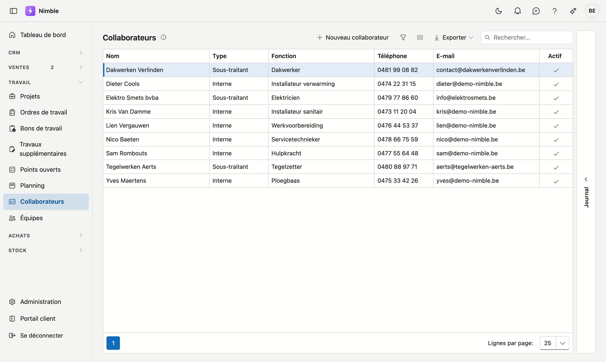
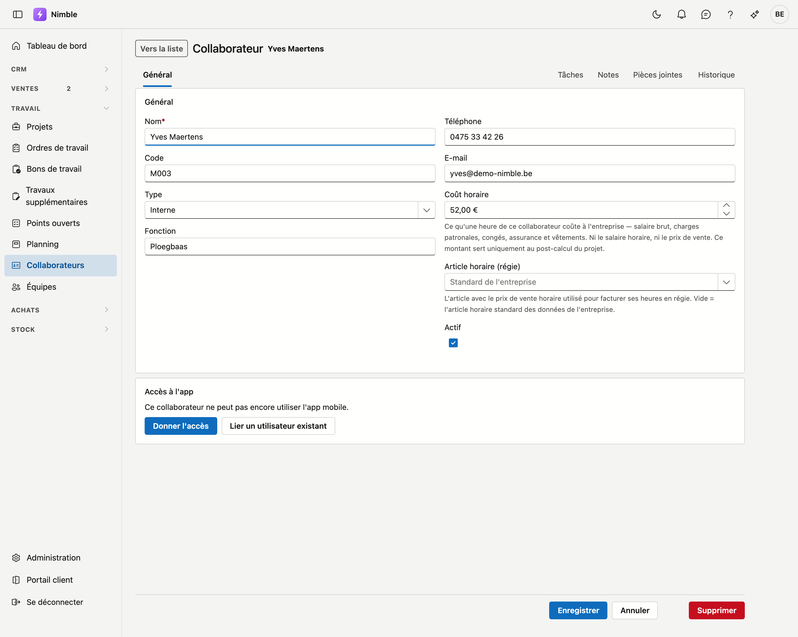
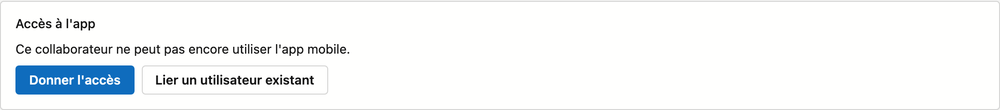
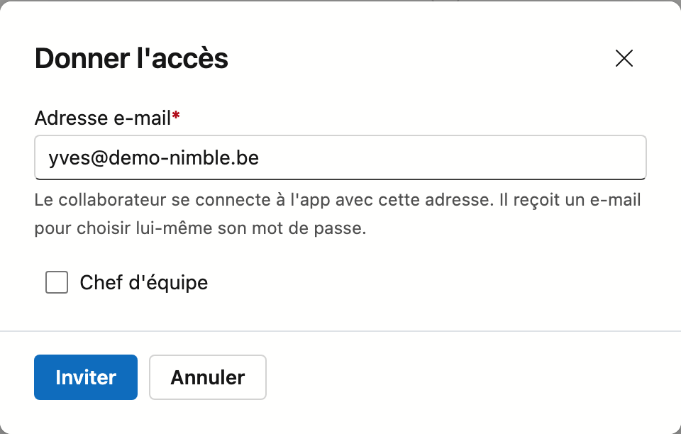

# Collaborateurs

Toutes les personnes qui interviennent sur vos chantiers : vos propres gens et les sous-traitants avec
lesquels vous travaillez. Nimble utilise cette liste pour affecter des heures sur les bons de travail et
pour calculer le prix de revient d'un projet.

## Ouvrir l'écran

Dans la barre latérale, cliquez sur **Travail → Collaborateurs**.

## La liste

La liste affiche six colonnes : **Nom**, **Type**, **Fonction**, **Téléphone**, **E-mail** et **Actif**.
Sous **Type** figure la distinction qui se répercute partout :

| Type | Ce que cela signifie |
|---|---|
| **Interne** | Quelqu'un sur votre liste de paie |
| **Sous-traitant** | Une partie externe à laquelle vous faites appel |

- **Nouveau collaborateur** ouvre une fiche vide.
- Les trois boutons à côté de Rechercher sont le filtre, le sélecteur de colonnes et **Exporter**.

À droite se trouve le tiroir **Journal**. Il concerne le collaborateur sur lequel se trouve votre curseur :
cliquez sur une ligne et ouvrez le tiroir avec la flèche. Vous y trouvez ses tâches, notes, pièces jointes
et son historique — pratique pour conserver une attestation ou un contrat auprès de la bonne personne sans
ouvrir la fiche.

## La fiche

Vous ouvrez une fiche en double-cliquant sur une ligne.

À gauche se trouve l'onglet **Général**, à droite **Tâches**, **Notes**, **Pièces jointes** et
**Historique**.

| Champ | Remarque |
|---|---|
| **Nom** | Obligatoire |
| **Code** | Votre propre référence, par exemple un numéro de personnel |
| **Type** | **Interne** ou **Sous-traitant** |
| **Fonction** | Ce que fait cette personne : installateur, chef d'équipe, électricien… |
| **Téléphone** | Vide est permis. Si vous saisissez quelque chose, ce doit être un numéro valide |
| **E-mail** | Vide est permis. Si vous saisissez quelque chose, ce doit être une adresse valide |
| **Coût horaire** | Voir ci-dessous — ce champ mérite votre attention |
| **Article horaire (régie)** | L'article avec le prix de vente horaire utilisé pour facturer ses heures en régie, par exemple *Werkuur installateur*. Vide = l'article horaire standard des [données de l'entreprise](../settings/company-profile.md). À ne pas confondre avec le coût horaire : celui-ci est ce qu'une heure coûte, l'article est ce qu'une heure coûte au client |
| **Actif** | Voir ci-dessous |

Si le téléphone ou l'e-mail n'est pas valide, cela s'affiche en haut à côté du nom. Si vous cliquez alors
sur **Enregistrer**, ou si le nom est vide, la fiche indique en haut ce qui manque.

En bas figurent **Enregistrer**, **Annuler** et, à part à droite, **Supprimer**. **Supprimer** demande
d'abord une confirmation ; le collaborateur va dans la corbeille.

### Le coût horaire

C'est *ce qu'une heure de travail de ce collaborateur coûte à votre entreprise* : salaire brut plus
charges patronales, congés, assurance et vêtements. Ce n'est donc pas le salaire horaire que le
collaborateur voit, ni le prix que vous facturez au client.

Nimble utilise ce montant à un seul endroit : le **post-calcul** sur la [fiche de projet](projects.md), où
les coûts réels sont confrontés au produit.

!!! warning "Sans coût horaire, un collaborateur compte pour zéro"
    Si vous laissez ce champ vide, les heures de cette personne ne coûtent rien dans le post-calcul. La
    marge du projet est alors trop élevée. La fiche de projet le signale dans un cadre orange sous le
    post-calcul, avec le nombre d'heures sans coût horaire. Complétez donc ce champ, même par une
    estimation.

### Actif

Décochez **Actif** pour qui ne travaille plus avec vous. Le collaborateur continue d'exister et reste dans
cette liste. Ses heures sur d'anciens bons de travail restent correctes.

Un collaborateur inactif n'est plus proposé dans les listes de choix : pour les heures d'un bon de travail,
pour les membres d'une équipe et pour le responsable d'un point de réception. S'il est déjà choisi quelque
part, ce choix reste simplement en place.

## Accès à l'app

En bas de la fiche figure le bloc **Accès à l'app**. Vous y donnez à un collaborateur l'accès à l'app mobile
Nimble, et vous le lui retirez. Dans l'app, il voit le planning de son équipe, remplit le bon
de travail et fait signer le client : voir [Le bon de travail dans l'app](../app/werkbon.md).

### Donner l'accès

1. Cliquez sur **Donner l'accès**.
2. Indiquez l'**Adresse e-mail** avec laquelle le collaborateur se connecte à l'app.
3. Cochez **Chef d'équipe** s'il saisit les heures de toute l'équipe et utilise le chronomètre.
4. Cliquez sur **Inviter**.

Le collaborateur reçoit un e-mail pour choisir lui-même son mot de passe. Tant qu'il ne l'a pas fait, *Invité*
s'affiche. Si l'e-mail n'est pas arrivé, cliquez sur **Réinviter**.

Le collaborateur travaille déjà dans Nimble, avec son propre compte utilisateur ? Cliquez alors sur
**Lier un utilisateur existant** et choisissez son utilisateur. Il se connecte à l'app avec ce compte ; rien de
nouveau n'est créé.

Un collaborateur inactif ou dans la corbeille ne reçoit pas d'accès à l'app.

### La case Chef d'équipe

| | Avec la case | Sans la case |
|---|---|---|
| Heures sur le bon de travail | Pour toute l'équipe | Uniquement ses propres heures ; il voit celles de ses collègues |
| Le chronomètre | Démarrer et arrêter | Uniquement le voir tourner |
| Rapport journalier, matériel, travaux supplémentaires, faire signer | Oui | Oui |

Vous cochez ou décochez la case quand vous le souhaitez. Elle s'applique dès l'action suivante dans l'app.

### Ensuite

Le bloc indique la situation : *Actif*, avec l'adresse avec laquelle il se connecte et quand il a utilisé l'app
pour la dernière fois.

- **Nouveau mot de passe** — le collaborateur reçoit un e-mail pour choisir un nouveau mot de passe.
- **Révoquer** — il ne peut plus utiliser l'app. Une app ouverte à ce moment fonctionne encore une heure au plus.
  Avec **Rétablir l'accès**, vous le lui rendez plus tard.
- Pour un collaborateur avec son propre compte utilisateur figure **Supprimer le lien**. Il garde son accès à
  Nimble ; seule l'app ne fonctionne plus. Son mot de passe se gère sous [Utilisateurs](../administration/users.md).

## Voir aussi

- [Équipes](teams.md) — regrouper des collaborateurs en une équipe
- [Projets](projects.md) — là où le post-calcul utilise ce coût horaire
- [Travailler avec une fiche](../fiches.md) — le fonctionnement des onglets et des boutons
