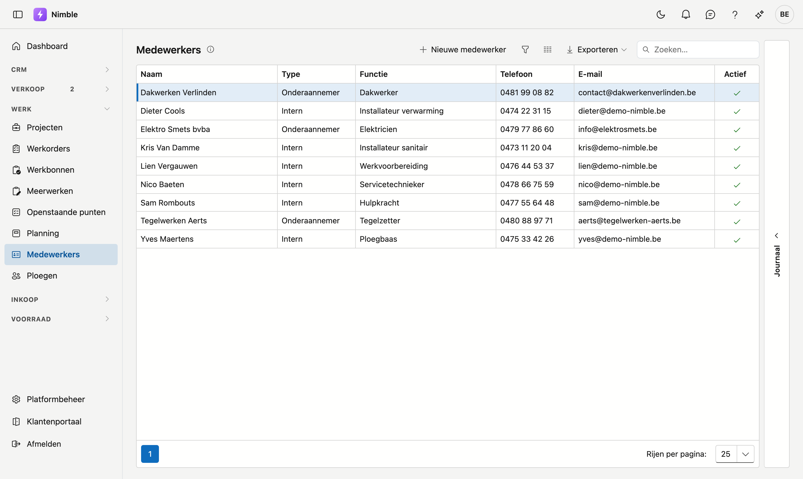
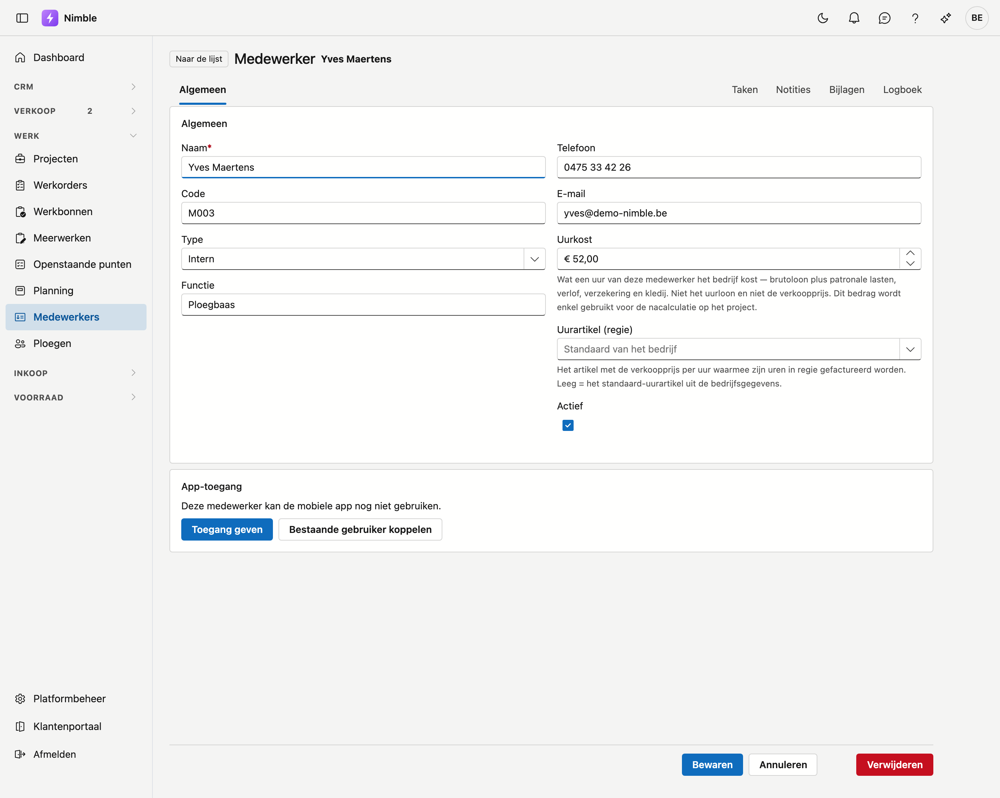
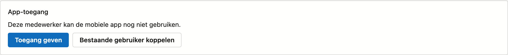
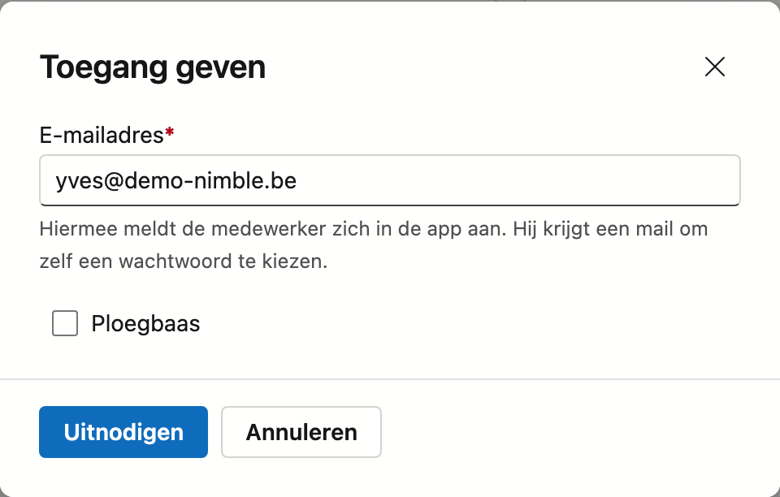

# Medewerkers

Iedereen die op uw werven staat: uw eigen mensen én de onderaannemers waarmee u werkt. Nimble gebruikt
deze lijst om uren toe te wijzen op werkbonnen en om de kostprijs van een project te berekenen.

## Het scherm openen

Klik in de zijbalk op **Werk → Medewerkers**.

## De lijst

De lijst toont zes kolommen: **Naam**, **Type**, **Functie**, **Telefoon**, **E-mail** en **Actief**. In
**Type** ziet u het onderscheid dat overal doorwerkt:

| Type | Wat het betekent |
|---|---|
| **Intern** | Iemand op uw loonlijst |
| **Onderaannemer** | Een externe partij die u inschakelt |

- **Nieuwe medewerker** opent een lege fiche.
- De drie knoppen naast Zoeken zijn de filter, de kolomkiezer en **Exporteren**.

Rechts zit de lade **Journaal**. Die hoort bij de medewerker waarop uw cursor staat: klik een rij aan en
klap de lade uit met de pijl. U vindt er zijn taken, notities, bijlagen en logboek — handig om een
attest of een contract bij de juiste persoon te bewaren zonder de fiche te openen.

## De fiche

U opent een fiche door te dubbelklikken op een rij.

Links staat het tabblad **Algemeen**, rechts **Taken**, **Notities**, **Bijlagen** en **Logboek**.

| Veld | Opmerking |
|---|---|
| **Naam** | Verplicht |
| **Code** | Uw eigen kenmerk, bijvoorbeeld een personeelsnummer |
| **Type** | **Intern** of **Onderaannemer** |
| **Functie** | Wat deze persoon doet: installateur, ploegbaas, elektricien… |
| **Telefoon** | Leeg mag. Vult u iets in, dan moet het een geldig telefoonnummer zijn |
| **E-mail** | Leeg mag. Vult u iets in, dan moet het een geldig adres zijn |
| **Uurkost** | Zie hieronder — dit veld verdient aandacht |
| **Uurartikel (regie)** | Het artikel met de verkoopprijs per uur waarmee zijn uren in regie gefactureerd worden, bijvoorbeeld *Werkuur installateur*. Leeg = het standaard-uurartikel uit de [bedrijfsgegevens](../settings/company-profile.md). Niet te verwarren met de uurkost: dat is wat een uur kost, dit is wat een uur de klant kost |
| **Actief** | Zie hieronder |

Is het telefoonnummer of het e-mailadres ongeldig, dan staat dat bovenaan naast de naam. Klikt u dan op
**Bewaren**, of is de naam leeg, dan zegt de fiche bovenaan wat er ontbreekt.

Onderaan staan **Bewaren**, **Annuleren** en, apart rechts, **Verwijderen**. **Verwijderen** vraagt eerst
een bevestiging; de medewerker gaat naar de prullenbak.

### De uurkost

Dit is *wat één gewerkt uur van deze medewerker uw onderneming kost*: brutoloon plus patronale lasten,
verlof, verzekering en kledij. Het is dus niet het uurloon dat de medewerker ziet, en niet de prijs die u
aan de klant aanrekent.

Nimble gebruikt dit bedrag op één plaats: de **nacalculatie** op de
[projectfiche](projects.md#het-blok-nacalculatie), waar de werkelijke kosten tegenover de opbrengst staan.

!!! warning "Zonder uurkost telt een medewerker voor nul"
    Laat u dit veld leeg, dan kosten de uren van deze persoon niets in de nacalculatie. De marge op het
    project staat dan te hoog. De projectfiche meldt dat in een oranje kader onder de nacalculatie, met het
    aantal uren zonder uurkost. Vul het veld dus in, ook bij een schatting.

### Actief

Zet **Actief** uit voor wie niet meer meewerkt. De medewerker blijft bestaan en blijft in deze lijst staan.
Zijn uren op oude werkbonnen blijven kloppen.

Een inactieve medewerker wordt niet meer voorgesteld in de keuzelijsten: bij de uren op een werkbon, bij de
leden van een ploeg en bij de eigenaar van een opleverpunt. Staat hij ergens al ingevuld, dan blijft die
keuze gewoon staan.

## App-toegang

Onderaan de fiche staat het blok **App-toegang**. Hier geeft u een medewerker toegang tot de mobiele app
*Nimble – werf & werkbon*, en trekt u ze weer in. In de app ziet hij de planning van zijn ploeg, vult hij de
werkbon in en laat hij de klant tekenen: zie [De werkbon in de app](../app/werkbon.md).

### Toegang geven

1. Klik op **Toegang geven**.
2. Vul het **E-mailadres** in waarmee de medewerker zich in de app aanmeldt.
3. Vink **Ploegbaas** aan als hij de uren van de hele ploeg invult en de klok bedient.
4. Klik op **Uitnodigen**.

De medewerker krijgt een mail om zelf zijn wachtwoord te kiezen. Tot hij dat gedaan heeft, staat er
*Uitgenodigd*. Kwam de mail niet aan, klik dan op **Opnieuw uitnodigen**.

Werkt de medewerker al in Nimble, met een eigen gebruikersaccount? Klik dan op
**Bestaande gebruiker koppelen** en kies zijn gebruiker. Hij meldt zich in de app aan met dat account; er wordt
niets nieuws aangemaakt.

Een medewerker die niet actief is of in de prullenbak zit, krijgt geen app-toegang.

### Het vinkje Ploegbaas

| | Met het vinkje | Zonder het vinkje |
|---|---|---|
| Uren op de werkbon | Voor iedereen van de ploeg | Enkel zijn eigen uren; die van de collega's ziet hij |
| De klok | Starten en stoppen | Enkel zien lopen |
| Dagrapport, materiaal, meerwerk, laten tekenen | Ja | Ja |

U zet het vinkje aan of uit wanneer u wil. Het geldt bij de volgende handeling in de app.

### Daarna

Het blok toont de stand: *Actief*, met het adres waarmee hij zich aanmeldt en wanneer hij de app het laatst
gebruikte.

- **Nieuw wachtwoord** — de medewerker krijgt een mail om een nieuw wachtwoord te kiezen.
- **Intrekken** — hij kan de app niet meer gebruiken. Een app die op dat moment open staat, werkt nog hoogstens
  een uur. Met **Opnieuw toegang geven** zet u ze later terug.
- Bij een medewerker met een eigen gebruikersaccount staat **Koppeling weghalen**. Hij behoudt zijn toegang tot
  Nimble; enkel de app werkt niet meer. Zijn wachtwoord beheert u bij [Gebruikers](../administration/users.md).

## Zie ook

- [Ploegen](teams.md) — medewerkers groeperen tot een ploeg
- [Projecten](projects.md) — waar de nacalculatie met deze uurkost rekent
- [Werken met een fiche](../fiches.md) — hoe de tabbladen en knoppen op elke fiche werken
