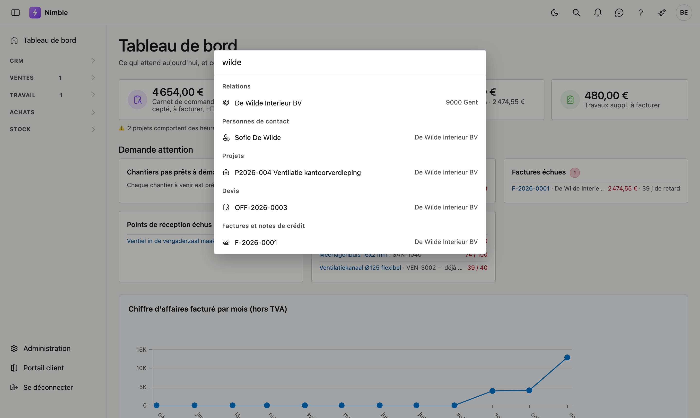

# Rechercher

Avec le champ de recherche en haut, vous retrouvez depuis chaque écran un client, un projet, un document ou un article, sans ouvrir
d'abord la bonne liste. Cela fonctionne aussi avec un numéro de téléphone : tapez le numéro de GSM de la personne qui appelle, et vous
voyez le client et ses projets.

## Ouvrir la recherche

Cliquez en haut à droite sur la loupe, ou appuyez sur **Ctrl-K** (sur un Mac **⌘K**). Tapez au moins trois caractères. Les résultats
apparaissent pendant que vous tapez, regroupés par type, avec au maximum cinq par type. Cliquez sur un résultat pour ouvrir la fiche.
Avec **Échap**, vous fermez la recherche.

## Ce que vous pouvez rechercher

| Type | Recherche sur |
|---|---|
| **Relations** | nom, code, adresse e-mail, téléphone, GSM, numéro de TVA |
| **Personnes de contact** | nom (prénom et nom de famille dans les deux ordres), adresse e-mail, téléphone, GSM |
| **Leads** | nom, entreprise, code, adresse e-mail, téléphone, numéro de TVA |
| **Projets** | code, nom, client, adresse du chantier |
| **Devis** | numéro, variante, référence du client |
| **Factures et notes de crédit** | numéro, référence du client, communication structurée |
| **Ordres de travail** | numéro, description |
| **Installations** | numéro de série, marque, modèle, nom du lieu |
| **Commandes** | numéro |
| **Factures d'achat** | numéro de facture du fournisseur, numéro propre, communication de paiement |
| **Articles** | code, nom, EAN, code chez le fournisseur |

À droite d'un résultat figure ce qui aide à le reconnaître : la commune pour une relation, la relation pour une personne de contact,
le client pour un projet, un devis ou une facture, le fournisseur pour une commande.

## Un client et tous ses documents

Si vous tapez le nom d'un client, vous voyez aussi ses projets, ses devis et ses factures. Pour un fournisseur, vous voyez ses
commandes et ses factures d'achat. Cela vaut aussi quand vous tapez son numéro de téléphone ou son numéro de TVA.

## Un numéro de téléphone

Tapez le numéro tel que vous l'avez : avec ou sans espaces, points ou barres obliques, avec un 0 devant ou avec +32. Nimble ne compare
que les chiffres, de sorte que **0477 73 09 28** trouve aussi **+32 477 730 928** et **0477/73.09.28**. Nimble cherche dans les champs
Téléphone et GSM des relations, des personnes de contact et des leads.

Un numéro compte à partir de six chiffres. Le début d'un numéro suffit, par exemple les six premiers chiffres.

## Retrouver un paiement

Vous voyez un paiement sur votre extrait de compte ? Collez la communication structurée dans la recherche, par exemple
**+++000/0000/00101+++**. Vous arrivez directement à la facture.

## Ce que vous voyez et ce que vous ne voyez pas

- Uniquement les types que vous pouvez consulter. Qui ne peut pas voir les factures ne les voit pas non plus dans la recherche.
- Ce qui se trouve dans la Corbeille n'apparaît pas.
- Une facture qui n'a pas encore de numéro apparaît comme **Brouillon (pas encore de numéro)**, avec le nom du client.

!!! tip "Rechercher dans une seule liste"
    La recherche en haut couvre tous les types. Pour affiner dans une seule liste, utilisez le champ de recherche et les filtres de
    cette liste : voir [Filtrer les listes](lijsten-filteren.md).
