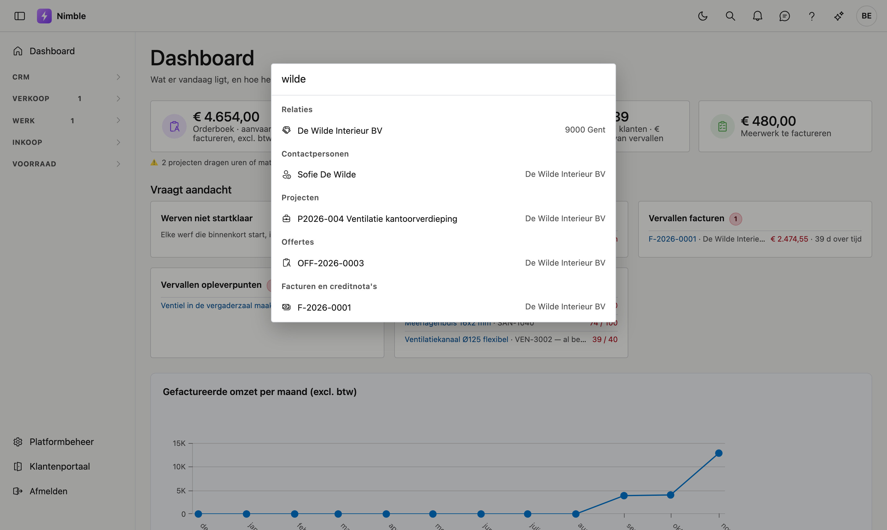

# Zoeken

Met het zoekvak bovenaan vindt u vanaf elk scherm een klant, een project, een document of een artikel terug, zonder eerst de
juiste lijst te openen. Dat werkt ook met een telefoonnummer: typ het gsm-nummer van wie belt, en u ziet de klant en zijn projecten.

## Het zoekvak openen

Het zoekvak staat bovenaan links, naast de naam Nimble. Klik erin, of druk op **Ctrl-K** (op een Mac **⌘K**) om de cursor erin te zetten.
Typ minstens drie tekens. De treffers verschijnen onder het vak terwijl u typt, gegroepeerd per soort, met hoogstens vijf per soort.
Klik op een treffer om de fiche te openen. Met **Esc**, of met een klik ernaast, sluit u de treffers en maakt u het vak leeg.

Op een smal scherm, zoals een tablet, staat er geen vak maar een vergrootglas naast de naam Nimble. Klik erop, of druk op **Ctrl-K**: het
zoekvak opent dan in het midden van het scherm.

U kunt ook zonder muis werken. De eerste treffer staat meteen gekozen; met de pijltjes **omhoog** en **omlaag** kiest u een andere, over
de soorten heen, en met **Enter** opent u de gekozen treffer. De gekozen treffer herkent u aan de blauwe rand links.

## Waarop u kunt zoeken

| Soort | Zoekt op |
|---|---|
| **Relaties** | naam, code, e-mailadres, telefoon, gsm, btw-nummer |
| **Contactpersonen** | naam (voornaam en familienaam in beide volgordes), e-mailadres, telefoon, gsm |
| **Leads** | naam, bedrijf, code, e-mailadres, telefoon, btw-nummer |
| **Projecten** | code, naam, klant, werfadres |
| **Offertes** | nummer, variant, referentie van de klant |
| **Facturen en creditnota's** | nummer, referentie van de klant, gestructureerde mededeling |
| **Werkorders** | nummer, omschrijving |
| **Installaties** | serienummer, merk, model, naam van de plaats |
| **Bestellingen** | nummer |
| **Aankoopfacturen** | factuurnummer van de leverancier, eigen nummer, betaalmededeling |
| **Artikelen** | code, naam, EAN, code bij de leverancier |

Rechts bij een treffer staat wat helpt om hem te herkennen: de gemeente bij een relatie, de relatie bij een contactpersoon, de klant
bij een project, offerte of factuur, de leverancier bij een bestelling.

## Een klant en al zijn documenten

Typt u de naam van een klant, dan ziet u ook zijn projecten, offertes en facturen. Bij een leverancier ziet u zijn bestellingen en
aankoopfacturen. Dat geldt ook wanneer u zijn telefoonnummer of btw-nummer typt.

## Een telefoonnummer

Typ het nummer zoals u het hebt: met of zonder spaties, punten of schuine strepen, met een 0 vooraan of met +32. Nimble vergelijkt
enkel de cijfers, zodat **0477 73 09 28** ook **+32 477 730 928** en **0477/73.09.28** vindt. Nimble zoekt in de velden Telefoon én
Gsm van relaties, contactpersonen en leads.

Een nummer telt vanaf zes cijfers. Het begin van een nummer volstaat, bijvoorbeeld de eerste zes cijfers.

## Een betaling terugvinden

Ziet u een betaling op uw rekeninguittreksel, plak dan de gestructureerde mededeling in het zoekvak, bijvoorbeeld
**+++000/0000/00101+++**. U komt meteen bij de factuur.

## Wat u ziet en wat niet

- Enkel de soorten die u mag bekijken. Wie geen facturen mag zien, ziet ze ook in het zoekvak niet.
- Wat in de Prullenbak staat, verschijnt niet.
- Een factuur die nog geen nummer heeft, verschijnt als **Klad (nog geen nummer)**, met de naam van de klant.

!!! tip "Zoeken binnen één lijst"
    Het zoekvak bovenaan zoekt over alle soorten. Wilt u in één lijst verder verfijnen, gebruik dan het zoekvak en de filters van die
    lijst: zie [Lijsten filteren](lijsten-filteren.md).
